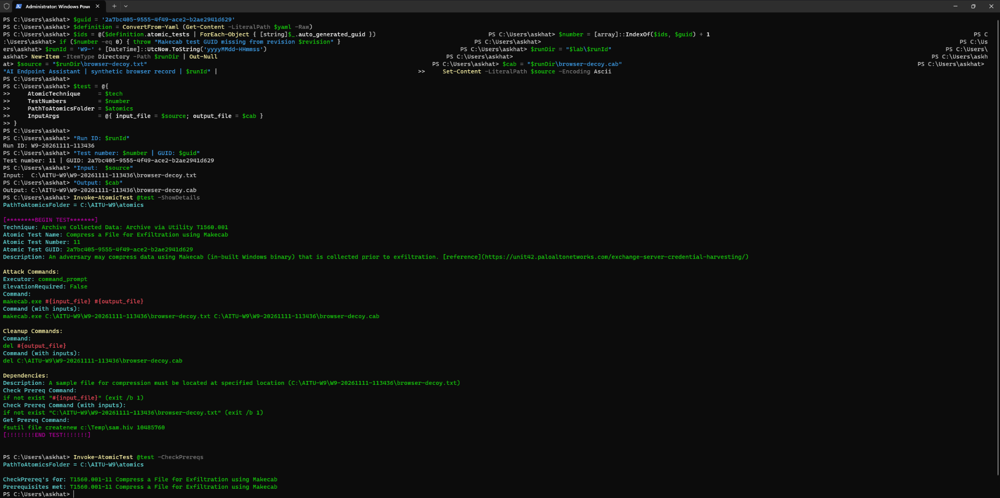
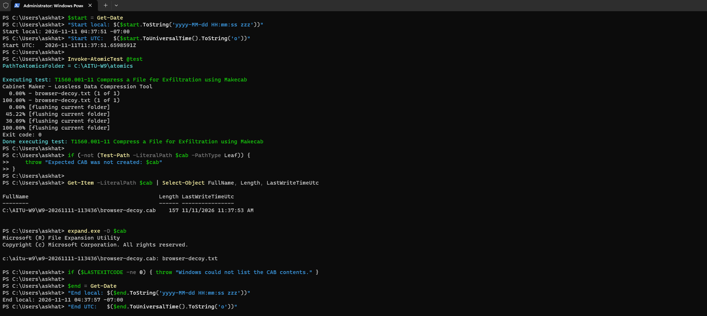
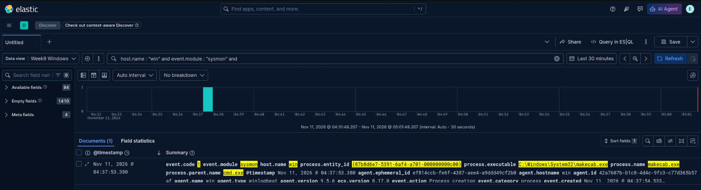
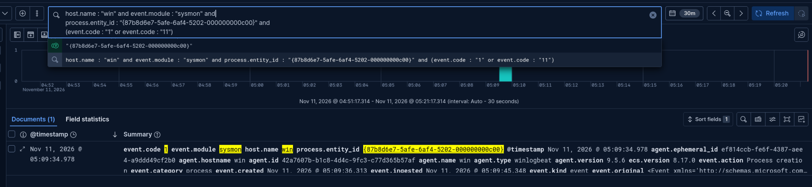
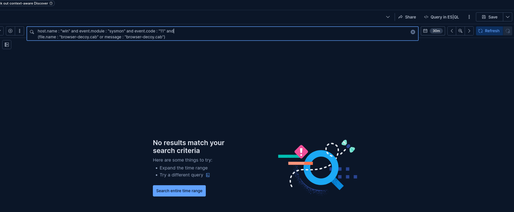
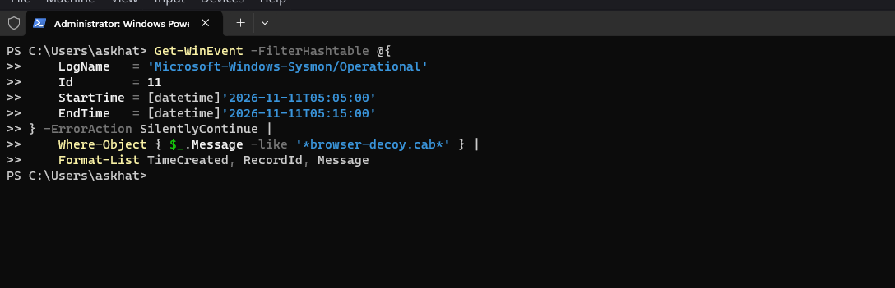

# Week 9 | Investigating a Windows archive with Atomic Red Team

**Local AI-Powered Cybersecurity Assistant for Personal Endpoints** · 11 November 2026

Can the assistant tell a user which program packaged a file and whether the archive was actually created? In Week 8, the [A4 collection ability](../week-08-adversary-emulation/emulation-plan/abilities/a4-browser-collection.yml) packaged decoy files with PowerShell `Compress-Archive` into a ZIP. This week we isolated the archiving step, used the Windows Cabinet Maker on one synthetic text file, and examined what Elastic could establish. The Atomic run produced a readable **157-byte CAB**. In a second execution of the same test, we traced the command to a specific process and searched for its file-write event.

## Environment and test identity

| Component | Recorded configuration |
|---|---|
| Endpoint | `win`, Windows 11 Enterprise Evaluation, x86-64, build `26300.9457` reported by Winlogbeat |
| Collection | Sysmon64 15.22, channel `Microsoft-Windows-Sysmon/Operational`, Winlogbeat 9.5.6 |
| SIEM | `askhat`, Ubuntu 26.04.1 LTS, Elasticsearch 9.5.6, Kibana 9.5.6, Discover data view `Week9 Windows` |
| Atomic | T1560.001, test 11, *Compress a File for Exfiltration using Makecab*, GUID `2a7bc405-9555-4f49-ace2-b2ae2941d629` |
| Execution | Windows PowerShell with Invoke-AtomicRedTeam. The YAML definition specifies the Windows command-prompt executor. Python was unused. Exact PowerShell and runner versions and the Atomic repository revision were not captured in the submitted evidence. |
| Inputs | One synthetic `browser-decoy.txt`. Destination `browser-decoy.cab` under a unique `C:\AITU-W9\W9-…\` directory. |

## What we observed

| Run | What the evidence establishes |
|---|---|
| `W9-20261111-113436` | The prerequisites passed. Cabinet Maker exited with code 0. Windows reported a 157-byte CAB, and `expand.exe -D` listed the expected member. Kibana showed the Makecab process at 04:37:53.380 local time. |
| `W9-20261111-120716` | Sysmon record **5436** captured the full Makecab command at **12:09:34.978 UTC** (05:09:34.978 local). Neither the Kibana filename search nor the local Sysmon search returned a matching CAB file-create event. |

### First run — verify the artifact

The runner resolved both inputs to the first run directory and confirmed the required source file existed.



The cabinet member listing supplied independent evidence of the outcome. The output path was `C:\AITU-W9\W9-20261111-113436\browser-decoy.cab`; its only listed member was `browser-decoy.txt`.



Discover showed one matching process start on `win`: `cmd.exe` launched `C:\Windows\System32\makecab.exe`. The local time in this view was UTC−07:00.



### Second run — trace the process and investigate file visibility

The exported [selected fields from record 5436](record-5436.json) identify Makecab PID **10872**, parent `cmd.exe` PID **5892**, and the following command line:

```text
makecab.exe  C:\AITU-W9\W9-20261111-120716\browser-decoy.txt C:\AITU-W9\W9-20261111-120716\browser-decoy.cab
```

To review the same evidence, select 11 November 2026, **12:05–12:15 UTC** in Discover (05:05–05:15 in the captured local time). This KQL selects the process instance and either event type:

```kql
host.name : "win" and event.module : "sysmon" and
process.entity_id : "{87b8d6e7-5afe-6af4-5202-000000000c00}" and
(event.code : "1" or event.code : "11")
```



We then removed the process GUID restriction and searched for the destination by name:

```kql
host.name : "win" and event.module : "sysmon" and event.code : "11" and
(file.name : "browser-decoy.cab" or message : "browser-decoy.cab")
```



On the endpoint, we queried Event ID 11 in the Sysmon Operational channel for 05:05–05:15 local and filtered the message for `browser-decoy.cab`. The query returned no rows. The same gap was visible at both ends. Its cause remains undetermined.



## Implications for the assistant

Record 5436 supports a user-facing explanation: **“Windows Command Prompt started Cabinet Maker to package browser-decoy.txt into browser-decoy.cab.”** The command line identifies the intended destination. A member listing or a corresponding file event provides stronger evidence of the outcome. Here, the member listing belongs to the first run. Neither run supplies evidence of data leaving the endpoint.

The [Week 5 PowerShell rule](../week-05-threat-hunting/powershell_rule.py) addresses suspicious PowerShell command lines. This experiment adds an example where the relevant child process is a native archiving utility. A future explanation should display the parent, input, destination and available corroboration. The submitted evidence establishes a Discover hunt; automatic alerting, baseline frequency and cleanup were not measured in the supplied results.

## Repeating the test

On a Windows endpoint with the Atomic runner and the T1560.001 definitions installed, check the GUID above with `-ShowDetails` before executing. Use a fresh directory for each run and keep the same PowerShell session for verification and cleanup. These commands assume the lab's definitions directory.

```powershell
$dir = 'C:\AITU-W9\W9-' + [DateTime]::UtcNow.ToString('yyyyMMdd-HHmmss')
New-Item -ItemType Directory -Path $dir -ErrorAction Stop | Out-Null
$src = Join-Path $dir 'browser-decoy.txt'
$cab = Join-Path $dir 'browser-decoy.cab'
"AI Endpoint Assistant | synthetic browser record | $(Split-Path $dir -Leaf)" |
    Set-Content -LiteralPath $src -Encoding Ascii
$test = @{
    AtomicTechnique = 'T1560.001'
    TestNumbers = 11
    PathToAtomicsFolder = 'C:\AITU-W9\atomics'
    InputArgs = @{ input_file = $src; output_file = $cab }
}
Invoke-AtomicTest @test -ShowDetails
Invoke-AtomicTest @test -CheckPrereqs
```

After verifying the GUID, resolved paths and prerequisites:

```powershell
Invoke-AtomicTest @test
Get-Item -LiteralPath $cab | Select-Object FullName, Length, LastWriteTimeUtc
expand.exe -D $cab
```

Capture the archive listing and process event. For cleanup, use `Invoke-AtomicTest @test -Cleanup`, check `Test-Path -LiteralPath $cab`, then remove the synthetic source with `Remove-Item -LiteralPath $src`.

[Official Atomic test definition](https://github.com/redcanaryco/atomic-red-team/blob/master/atomics/T1560.001/T1560.001.yaml) · [Microsoft Sysmon event reference](https://learn.microsoft.com/sysinternals/downloads/sysmon)
