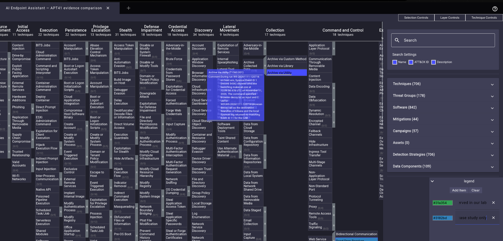

# Week 10 | APT41 techniques and personal endpoint evidence

**Local AI-Powered Cybersecurity Assistant for Personal Endpoints** · Enterprise ATT&CK group **G0096**

We selected APT41 because MITRE describes a specific use of Windows Cabinet Maker that we could compare with our own telemetry. Week 8 supplied the decoy-data scenario. Week 9 supplied the controlled Windows observation. APT41 is the subject of the published case study; our group operated the lab endpoint. [Week 9 experiment](../week-09-atomic-red-team/week9-work.md) · [MITRE APT41 profile](https://attack.mitre.org/groups/G0096/)

## Procedure-to-evidence mapping

| Tactic and technique | Published APT41 procedure | Evidence and interpretation for the assistant |
|---|---|---|
| Collection · **T1560.001 Archive via Utility** | MITRE documents APT41 using `makecab.exe` to archive a file. Mandiant also reports creating RAR archives of selected files before transfer. | **Green.** We reproduced the Makecab operation on synthetic data. Our first run produced a readable CAB. In the second run, record 5436 identified the command, parent and two file paths. This supports the archiving sub-technique. A data transfer would require additional evidence. |
| Discovery · **T1049 System Network Connections Discovery** | APT41 used `netstat` during reconnaissance to identify network resources. | **Blue.** Published procedure only. On a personal computer, a user or support tool may also inspect connections. An explanation should identify who launched the utility and what else occurred in the same session before assigning intent. |
| Command and Control · **T1102.001 Dead Drop Resolver** | APT41 used content on legitimate services, including GitHub and Pastebin, to point malware to command-and-control infrastructure. | **Blue.** Published procedure only. This matters to the project's URL-analysis feature: domain reputation alone misses how a specific page is used. To support this mapping locally, an analyst would need evidence connecting the retrieved content to a subsequent destination. |

Sources: [Mandiant, *APT41, A Dual Espionage and Cyber Crime Operation*](https://www.mandiant.com/sites/default/files/2022-02/rt-apt41-dual-operation.pdf) · [MITRE archiving procedure examples](https://attack.mitre.org/techniques/T1560/001/) · [MITRE APT41 procedures for discovery and command and control](https://attack.mitre.org/groups/G0096/)

## Read the Navigator layer

Open the [exported layer](apt41-endpoint-evidence.json) in [ATT&CK Navigator](https://mitre-attack.github.io/attack-navigator/) using **Open Existing Layer → Upload from local**. The export records ATT&CK **20**, Navigator **5.3.2** and layer format **4.5**. Select T1560.001 to inspect the run ID, record number, timestamp and Event 11 search result.

| Layer color | Meaning |
|---|---|
| Green · `#31a354` | Documented for APT41 and observed in our lab |
| Blue · `#3182bd` | Documented for APT41, case study only |

The colored cells describe the source of evidence. A shared executable is enough to compare procedures, but it does not identify the operator. In this case, the known lab operator and synthetic input let us evaluate what an assistant can explain without inferring malicious intent.

## Group defense plan · 7 minutes 30 seconds

| Time | What to show and explain |
|---|---|
| 0:00–0:45 | Open Week 8 A4. Explain why testing a second archiving utility is relevant to monitoring local processes. |
| 0:45–2:15 | Show Week 9 figures 1 and 2. Point out the test GUID, decoy input, exit code, 157-byte CAB and verified member. |
| 2:15–4:30 | Show figures 3–6. Distinguish the two run IDs. Explain how record 5436 establishes the parent and paths, and how the two file-event searches limit the conclusion. |
| 4:30–6:30 | Open the layer. Explain all three procedures and why only the archiving technique is green. |
| 6:30–7:30 | Give the endpoint-user explanation. Identify what further evidence would establish a completed write or transfer for the second run. |

**Documentation credit.** The group supplied the experiment screenshots, event export and Navigator layer. ChatGPT assisted with the practical guide, evidence interpretation and preparation of the Week 9–10 reports.
